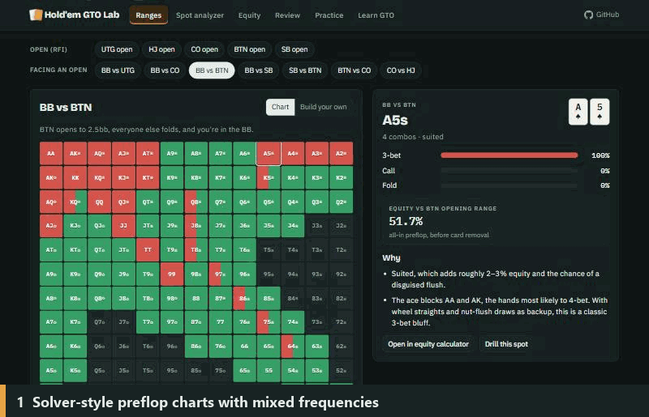
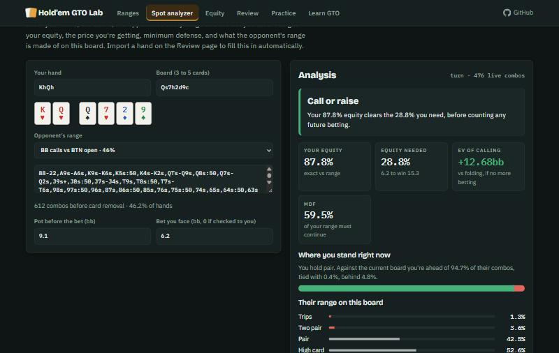
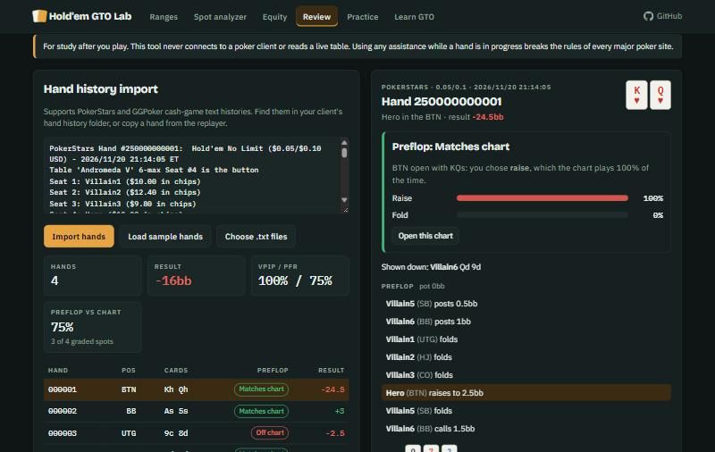
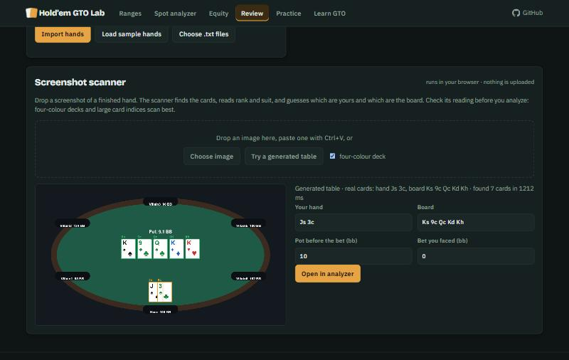
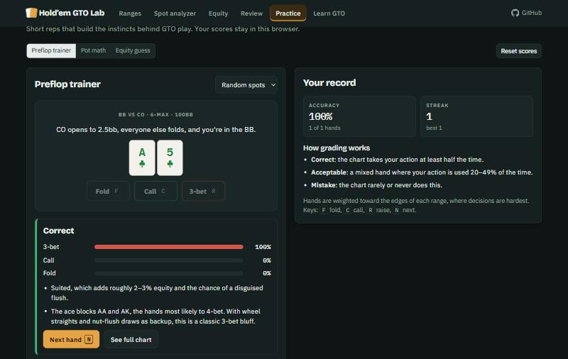

<div align="center">

# Hold'em GTO Lab

**A free, open-source poker study lab that runs entirely in your browser.**
Solver-style preflop charts, a postflop spot analyzer, an equity calculator, hand history review, a screenshot card scanner, practice drills and GTO lessons. No sign-up, no server, no build step.

[**Open the live app →**](https://naingzwehtut.github.io/holdem-gto-lab/)

[](https://github.com/Naingzwehtut/holdem-gto-lab/actions/workflows/ci.yml)
[](LICENSE)




</div>

## Why this exists

Commercial GTO tools cost $30–$100 a month and hide how they work. This lab gives you the core study loop for free, with every line of code open:

1. **Learn** the ideas behind solver output: pot odds, MDF, bluff ratios, blockers, mixed strategies.
2. **Drill** preflop decisions and pot math until they're automatic.
3. **Review** your real hands after a session and see exactly where you left the baseline.

## Features

|                         |                                                                                                                                                                                                                        |
| ----------------------- | ---------------------------------------------------------------------------------------------------------------------------------------------------------------------------------------------------------------------- |
| **Preflop ranges**      | 12 spots for 6-max cash at 100bb (all opens, plus BB, SB, BTN and CO facing a raise). Mixed frequencies, equity vs the opener, and a plain-English reason for every hand. Includes a range builder with drag painting. |
| **Spot analyzer**       | Your hand, the board, a villain range and the bet you face → exact turn/river equity, the equity you need, EV of calling, MDF, what the villain's range holds on this board, and a bet-sizing table.                   |
| **Equity calculator**   | 2–6 players, each holding exact cards, a weighted range or a random hand. Exact enumeration where possible, Monte Carlo otherwise.                                                                                     |
| **Hand history review** | Import PokerStars or GGPoker hand histories. See VPIP/PFR and results, grade every preflop decision against the charts, and open any postflop decision in the analyzer with one click.                                 |
| **Screenshot scanner**  | Drop a screenshot of a finished hand. Computer vision in the browser finds the cards, reads rank and suit, and sends them to the analyzer.                                                                             |
| **Practice**            | Preflop trainer (weighted toward the hard, borderline hands), pot-math quiz, and an equity-guessing game. Scores are saved locally.                                                                                    |
| **Learn GTO**           | Eight short interactive lessons, from Nash equilibrium to when to deviate.                                                                                                                                             |

<table>
<tr>
<td></td>
<td></td>
</tr>
<tr>
<td></td>
<td></td>
</tr>
</table>

## Quick start

Use the [live app](https://naingzwehtut.github.io/holdem-gto-lab/), or run it locally (Node 22+):

```bash
git clone https://github.com/Naingzwehtut/holdem-gto-lab.git
cd holdem-gto-lab
npm start            # http://localhost:5173
```

`npm start` runs a tiny dependency-free static server. Any static server works, because the app is plain HTML, CSS and ES modules.

For development:

```bash
npm install          # ESLint and Prettier only
npm test             # 26 tests: evaluator, equity, ranges, hand histories, scanner
npm run check        # lint + tests
```

## How it works

- **Hand evaluator:** cards are integers; one pass builds rank counts and suit bitmasks, and the score packs category and kickers into a single comparable integer. Millions of 7-card hands per second, no lookup tables.
- **Equity:** exact enumeration when every hand is known and at most two cards are to come, weighted Monte Carlo sampling with card-removal rejection otherwise.
- **Hand histories:** a line-by-line parser that tracks each player's street commitment, so it knows the pot and price before every action.
- **Scanner:** connected-component labelling to find card faces, then normalised cross-correlation of each corner index against glyph templates rendered in the browser; suit from ink colour and glyph shape.

Read [docs/ARCHITECTURE.md](docs/ARCHITECTURE.md) for the details.

## Accuracy and limits

- **The charts are approximations** of published solver solutions for 6-max, 100bb, 2.5bb opens, simplified by hand. Treat them as a study baseline, not exact solver output.
- **The analyzer starts from preflop ranges.** Narrow the villain range for later streets to get sharper numbers.
- **The scanner** reads 100% of cards on the built-in generated tables (280/280 in testing). Real client screenshots vary: four-colour decks and large card indices work best, and you can correct any card before analyzing.

## Responsible use

This is a **study and post-session review** tool.

- It never connects to a poker client, never captures your screen, and never reads a live table.
- Hand histories and screenshots are processed in your browser and never uploaded.
- Using any real-time assistance during a hand breaks the terms of service of PokerStars, GGPoker and every other major site, and can get your account closed and your balance confiscated. Contributions that add live-play assistance will not be accepted.

## Roadmap

- [ ] More spots: 3-bet pots, 4-bet ranges, 40bb and 200bb stacks
- [ ] Postflop c-bet frequency drills by board texture
- [ ] Hand histories from Winamax, iPoker, 888 and ACR
- [ ] Range vs range equity heatmaps
- [ ] Installable PWA with offline support
- [ ] Translations

Ideas and votes are welcome in [Issues](https://github.com/Naingzwehtut/holdem-gto-lab/issues).

## Contributing

Pull requests are welcome. Start with [CONTRIBUTING.md](CONTRIBUTING.md); the engine is plain JavaScript with tests, so it's an easy codebase to learn. If this project helps your game, a ⭐ helps other players find it.

## License

[MIT](LICENSE) © 2026 Naingzwehtut
